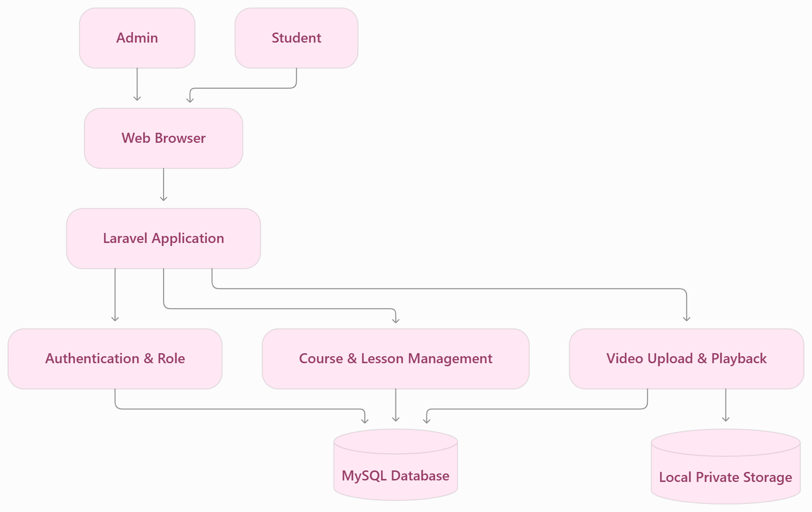
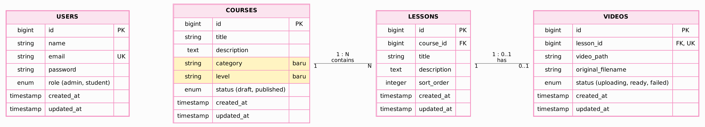
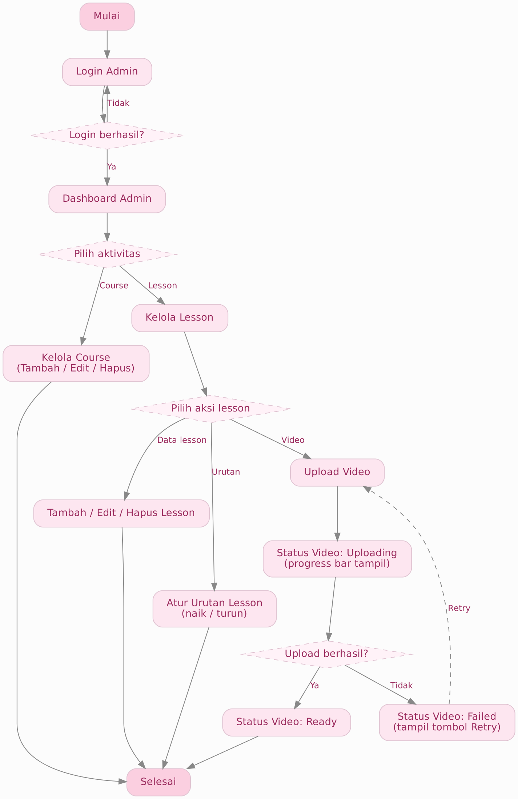
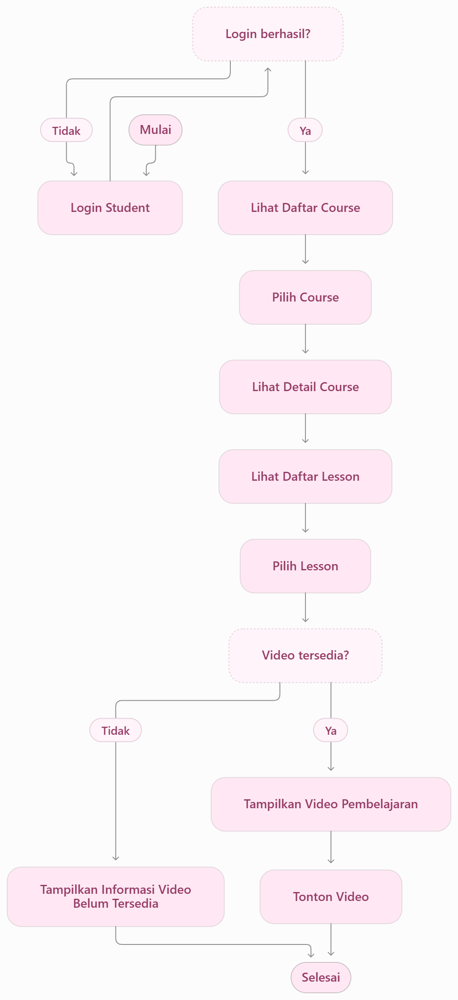

# LearnSpace: Simple E-Learning Platform

Aplikasi E-Learning sederhana dengan area Admin dan Student.
Admin mengelola course dan lesson (video), Student menonton.

## Teknologi

| Teknologi | Alasan |
|---|---|
| Laravel 12 (PHP 8.2) | Diwajibkan brief. Routing, validasi, Eloquent, dan middleware sudah matang |
| MySQL | Diwajibkan brief. Cocok untuk data relasional course, lesson, video |
| Blade + Tailwind (Breeze) | Server-side rendering sederhana, cepat dibuat, mudah dirawat |
| Vanilla JS (XHR) | Upload dengan progress bar tanpa framework tambahan |

## Fitur

- Login Admin dan Student, akses halaman dibedakan per role (middleware `role`)
- Admin: CRUD course (judul, deskripsi, kategori, level, status draft/published)
- Admin: CRUD lesson, urutan naik/turun
- Admin: upload video dengan progress bar, status `uploading`, `ready`, `failed`, dan Retry
- Video disimpan di storage private dan hanya bisa diakses lewat controller yang mengecek login dan role
- Student: daftar course published, detail course dengan lesson, player video

## Requirement

- PHP >= 8.2, Composer, Node.js >= 18, MySQL

## Instalasi

```bash
git clone https://github.com/nurussaidatilchamidah/learnspace.git
cd learnspace
composer install
npm install
copy .env.example .env      # Linux/Mac: cp .env.example .env
php artisan key:generate
```

Atur `.env`:

```env
DB_CONNECTION=mysql
DB_HOST=127.0.0.1
DB_PORT=3306
DB_DATABASE=learnspace
DB_USERNAME=root
DB_PASSWORD=
```

Buat database kosong `learnspace`, lalu:

```bash
php artisan migrate --seed
```

Naikkan batas upload di `php.ini`, lalu restart server:

```ini
upload_max_filesize = 512M
post_max_size = 520M
max_execution_time = 300
```

## Menjalankan

Jalankan di dua terminal:

```bash
npm run dev
php artisan serve
```

Buka http://127.0.0.1:8000

## Akun demo

| Role | Email | Password |
|---|---|---|
| Admin | admin@learnspace.test | password |
| Student | student@learnspace.test | password |

## Dokumen desain





Prototype UI: (tempel link Figma di sini)

## Asumsi

- Satu lesson memiliki satu video (relasi 1:1)
- Format video: MP4, MOV, WebM, maksimal 500 MB
- Video disimpan di `storage/app/private`, tanpa object storage, queue, atau transcoding
- Student dapat melihat semua course berstatus published tanpa proses enrollment
- Status video: `uploading` (sedang diproses), `ready` (siap ditonton), `failed` (gagal, bisa retry)
- Student hanya dapat menonton video `ready` dari course yang published
- Lesson dibuat lebih dulu, lalu video diupload di halaman edit lesson (video membutuhkan lesson yang sudah tersimpan)
- Registrasi mandiri hanya membuat akun Student. Akun Admin hanya dibuat lewat seeder
- Seeder membuat course dan lesson contoh tanpa video. Video tidak disertakan di repository
  (disimpan di storage private), upload sendiri lewat akun admin untuk mencoba pemutaran

## Keterbatasan

- Belum ada fitur enrollment, progress belajar, rating, dan review
- Upload tidak bisa dilanjutkan (resume) jika koneksi terputus, hanya diulang dari awal
- Tidak ada transcoding atau adaptive streaming, video diputar apa adanya
- Proses upload bersifat sinkron di server, jadi file sangat besar bergantung pada batas PHP
- Pengurutan lesson memakai tombol naik/turun, belum drag-and-drop
- Fitur di mockup yang tidak dikerjakan: section, dashboard statistik, halaman Students/Analytics/Settings
- Tampilan mengikuti mockup Figma untuk halaman utama. Menu Overview, Students, Analytics, Settings,
  serta rating, progress belajar, dan section tidak diimplementasikan